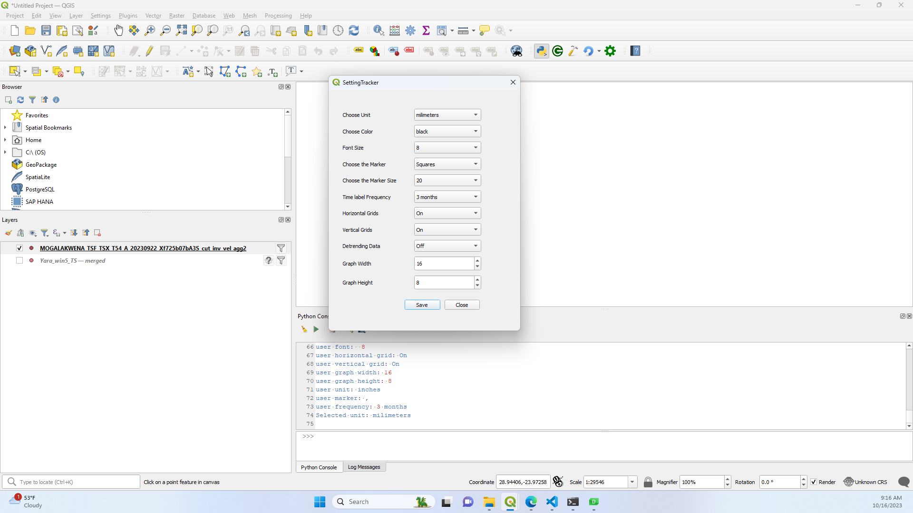

# SettingTracker QGIS Plugin

## Description

`SettingTracker` is a QGIS plugin designed to allow users to save their preferred settings for time series visualization. These configurations can be easily accessed and used at a later time. The plugin provides an intuitive graphical interface with multiple visual customization options.

## Features

- Dropdown menu to select marker sizes.
- Option to choose the desired display unit.
- Selection for preferred marker style.
- Combinatorial options for color and font selection.
- Ability to select both horizontal and vertical grid styles.
- Ability to select the time label frequency printed on the graphs
- Input fields to specify graph width and height.
- Save settings functionality that stores configurations as an XML file on the user's desktop.

## Installation

1. Move the `SettingTracker` folder into the QGIS plugins directory.
2. Launch QGIS and go to `Plugins > Manage and Install Plugins`.
3. Find `SettingTracker` under the `Installed` tab and ensure it's activated.

## Usage

1. Access the `SettingTracker` dialog within QGIS.
2. Utilize the dropdown menus and input fields to customize your settings.
3. Click the `OK` button to save your configurations. This will create an XML file named `user_settings.xml` on your desktop.
4. If you wish to discard changes, hit the `Cancel` button.

## Dependencies

- QGIS (with Python support)
- PyQt5
- `UserSettings` module

## Developer Information

- **Name:** Matt
- **Email:** [HatamiMatt@gmail.com](mailto:HatamiMatt@gmail.com)
- **Date Created:** 2023-10-06
- **License:** GNU General Public License (GPLv2 or later)

## Acknowledgments

This plugin was developed using the [Plugin Builder](http://g-sherman.github.io/Qgis-Plugin-Builder/).
